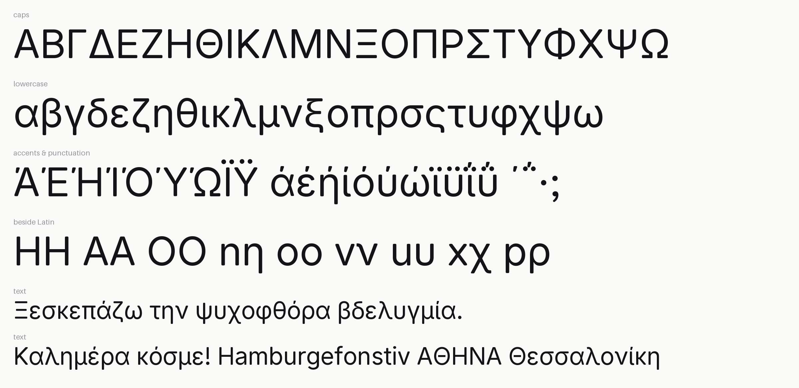
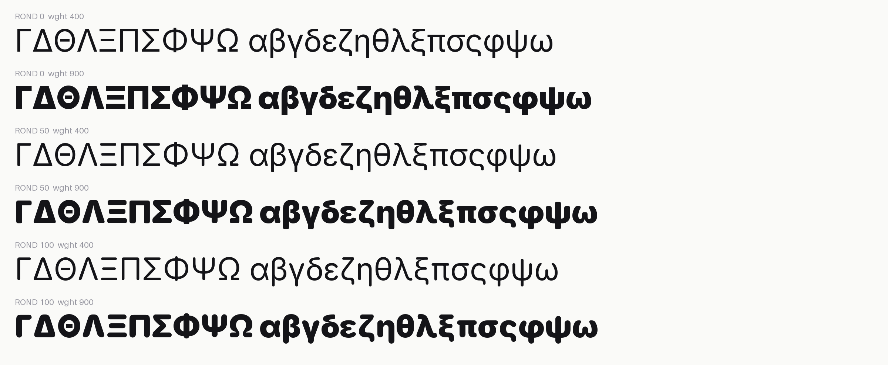
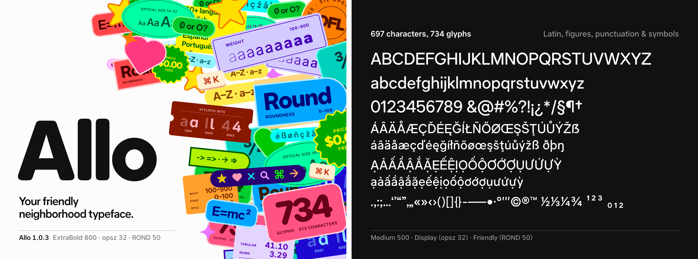
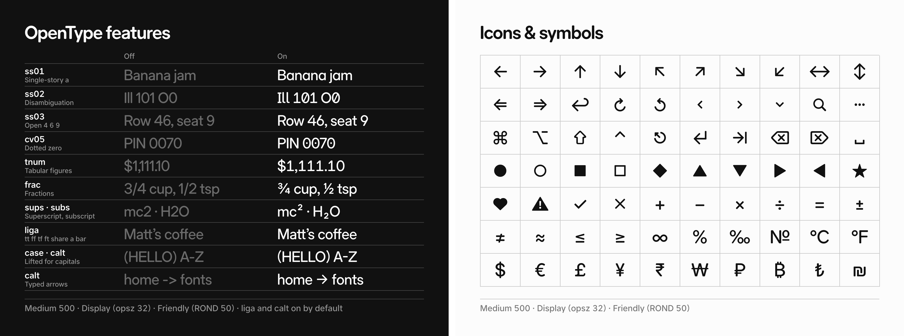

# Allo GR

**Allo with Greek.** A fork of [Allo](https://github.com/joshpuckett/allo) by Josh Puckett that adds a full monotonic
Greek: Α–Ω, α–ω with ς, every tonos and dialytika (Ά Έ Ή Ί Ό Ύ Ώ Ϊ Ϋ ά έ ή ί ό ύ ώ ϊ ϋ ΐ ΰ), ΄ ΅ · and the Greek
question mark, plus Ω (U+2126) and ∆ (U+2206). The Greek follows all three axes (optical size, weight, roundness),
the nine static weights and their obliques, and is kerned with the Latin. The family name stays **Allo**, so it is a
drop-in replacement.




## React

```sh
npm install github:L12-MC/Allo-GR
```

Load the font once, at your app's root (`main.jsx`, `app/layout.tsx`, `_app.tsx`):

```js
import "allo-gr";                 // @font-face for the variable font and the obliques
```

Then use it as a family, or with the component for the axes:

```jsx
import { Allo, alloStyle } from "allo-gr/react";

<Allo as="h1" weight={800} roundness={100}>Καλημέρα κόσμε</Allo>
<Allo weight={400} opticalSize={9}>Μικρό κείμενο</Allo>
<Allo oblique features={{ tnum: true }}>€1.234,50</Allo>
<p style={alloStyle({ weight: 600, roundness: 0 })}>Αιχμηρό</p>
```

| Prop | Values |
|---|---|
| `weight` | 100–900 |
| `roundness` | 0 sharp, 50 friendly (default), 100 round |
| `opticalSize` | `"auto"` (default, follows font size), `"none"`, or 9–32 |
| `oblique` | `true` for the obliques |
| `features` | `{ ss01: true, tnum: true }` or a `font-feature-settings` string |
| `as` | any element or component (default `span`) |

Roundness is passed down through `--allo-rond`, so setting it on a wrapper rounds everything inside.

**Tailwind CSS v4** — one import in your main CSS file:

```css
@import "tailwindcss";
@import "allo-gr/tailwind.css";
```

`font-sans` and `font-allo` are Allo; `rond-0` … `rond-100` (or `rond-[37]`) set the roundness:

```jsx
<h1 className="font-allo font-black rond-100">Γεια σου!</h1>
```

**Next.js `next/font`** (self-hosted, no layout shift):

```js
import localFont from "next/font/local";
export const allo = localFont({
  src: [{ path: "../node_modules/allo-gr/fonts/webfonts/AlloVariable.woff2", weight: "100 900", style: "normal" }],
  variable: "--font-allo",
});
// <html className={allo.variable}>  …  font-family: var(--font-allo)
```

## Greek sources

The Greek is generated into every source by `tools/greek/make_greek.py`, and `tools/greek/proof.py` renders the
proof sheets in `documentation/greek-*.png`:

```sh
git clone --depth 1 --filter=blob:none --sparse https://github.com/rsms/inter && (cd inter && git sparse-checkout set src)
.venv/bin/python tools/greek/make_greek.py --inter inter/src/Inter-Roman.glyphspackage
.venv/bin/python build.py
.venv/bin/python tools/greek/proof.py
```

- Letters that share a Latin shape (Α Β Ε Ζ Η Ι Κ Μ Ν Ο Ρ Τ Υ Χ, ο μ κ) are components of Allo's own glyphs, and Γ is
  Allo's L turned over, so they follow every edit, axis and sparse layer of the Latin.
- The rest start from Inter 4 (Allo's own starting point, with the same metrics and stems), interpolated to each
  master's optical size and weight, respaced with Allo's sidebearings, then given Allo's corners: each convex corner
  becomes the arc Allo draws, with the radius and handle measured from that master's L. Every master gets the same
  points, so the variable font interpolates.
- Tonos and dialytika are placed by anchors; static obliques are the upright Greek slanted 9°, then rounded.

Run the script again after editing a Latin letter; it only rewrites the Greek glyphs it owns.

---

*Below is the original Allo README.*

# Allo

Allo is your friendly neighborhood typeface. It’s variable in weight and roundness, with proportions and curves
designed to feel warm without being too cute and clear without being too cold. It’s a perfect companion out of the
box, and three variable axes and plenty of alternates let you tune its personality to exactly what you need.

Allo is optimized for screens and interfaces, with an optical size that adjusts automatically between text and
display. And it’s packed with big little details: tabular figures, fractions, punctuation that lifts beside capitals,
arrows that appear when you type them, a host of alternates and symbols, as well as a true oblique in every weight.

### [Type specimen at allo.joshpuckett.me →](https://allo.joshpuckett.me)

<br>




## Download

Get `Allo-1.0.3.zip` from the [latest release](https://github.com/joshpuckett/allo/releases/latest):

| Folder | Contents |
|---|---|
| `fonts/otf` | 18 static fonts, Thin to Black, each with an Oblique |
| `fonts/variable` | `AlloVariable.ttf`: all optical sizes, weights and roundnesses |
| `fonts/webfonts` | The same fonts as WOFF2, plus `AlloVariableFriendly.woff2` (roundness fixed at 50, about half the size) |

The static and variable fonts are separate families, **Allo** and **Allo Variable**, so both can be installed.

## Web

From npm:

```sh
npm install allo-font
```

```js
import "allo-font";            // the full variable font, and the obliques
// import "allo-font/friendly"; // or: roundness fixed at 50, about half the size
```

```css
body {
  font-family: "Allo", system-ui, sans-serif;
}
```

Or host the files yourself, from `fonts/webfonts`:

```css
@font-face {
  font-family: "Allo";
  src: url("AlloVariable.woff2") format("woff2");
  font-weight: 100 900;
  font-style: normal;
  font-display: swap;
}

body {
  font-family: "Allo", system-ui, sans-serif;
}
```

- **Optical size** follows the font size (`font-optical-sizing: auto`, the CSS default). Set it to `none` to keep the
  Text design at every size, or pick one with `font-variation-settings: "opsz" 32`.
- **Roundness** has no CSS property: use `font-variation-settings: "ROND" 0` (sharp) to `"ROND" 100` (round).
  Default 50.
- **Smaller file:** `AlloVariableFriendly.woff2` has roundness fixed at 50; `"ROND"` has no effect. Its family name
  is "Allo Variable Friendly".
- **Obliques:** the npm CSS includes them. Self-hosting, add an `@font-face` with `font-style: italic` and the matching `font-weight` for each oblique WOFF2
  you use (`Allo-Oblique.woff2`, `Allo-BoldOblique.woff2`, …).

## Axes

| Axis | Tag | Range | Default | Named values |
|---|---|---|---|---|
| Optical size | `opsz` | 9–32 | 14 | 9 Small, 14 Text, 32 Display |
| Weight | `wght` | 100–900 | 400 | Thin 100 to Black 900 |
| Roundness | `ROND` | 0–100 | 50 | 0 Sharp, 50 Friendly, 100 Round |

Display (32) is tighter, with stronger optical corrections. Below 14 only the spacing changes. The static fonts are
the variable font at opsz 14, ROND 50.

## OpenType features

| Feature | Effect |
|---|---|
| `ss01` Single-story a | ɑ-shaped a |
| `ss02` Disambiguation | Serifed I, tailed l, footed 1, slashed zero |
| `ss03` Open figures | Open 4, 6 and 9 |
| `cv01`–`cv04` | Footed 1, slashed zero, tailed l, serifed I, separately |
| `cv05` | Dotted zero |
| `tnum` | Tabular figures |
| `zero` | Slashed zero |
| `frac` | Fractions: 1/2 → ½ |
| `sups`, `subs`, `numr`, `dnom` | Superscript, subscript, numerator, denominator |
| `case` | Punctuation and symbols raised for capitals |
| `liga` | tt, ff, tf, ft with a shared crossbar |
| `calt` | `->` → →; brackets, signs, ¿ and ¡ raised beside capitals and figures |

Browsers turn ligatures off when letter-spacing is set. For code, use `font-variant-ligatures: no-contextual`.

## Build

Python 3.9 or newer:

```sh
python3 -m venv .venv
.venv/bin/python -m pip install -r requirements.txt
.venv/bin/python build.py
```

Writes `fonts/` (variable TTF and WOFF2; 18 static OTFs and WOFF2s, autohinted with AFDKO), `fonts/SHA256SUMS` and
`Allo-1.0.3.zip`. Dependencies are pinned and `release.json` fixes the timestamp, so builds are reproducible.

## Sources

`sources/Allo.designspace` (designspace 5, UFO) has 48 masters: opsz 9, 14, 20, 32 × wght 100, 400, 580, 900 ×
ROND 0, 50, 100, plus eight sparse layers at ROND 10 and 30 for heavy joins. The opsz 9 masters are the opsz 14
masters with wider spacing (`release.json` "smallShift"). Corners are rounded in the outlines; the build compiles
the sources as they are. Keep points compatible across masters.

`sources/static` holds the 18 static fonts' sources: cut from the variable masters at opsz 14, ROND 50, then edited
separately. The obliques are separate drawings, not a slant axis.

## Contributing

Found a problem, or missing a character? Please [open an issue](https://github.com/joshpuckett/allo/issues); a
screenshot and the text you typed help a lot.

Pull requests that change the masters or the font files aren't accepted for now. Every change to a letter gets
reviewed by eye across all the weights and axes, and that's hard to do well for work that arrives from outside. If
you have a larger idea, such as a new script, open an issue first so we can talk about it.

You're free to modify Allo and ship your own version under the [license](OFL.txt).

## License

[SIL Open Font License 1.1](OFL.txt): free to use, modify and redistribute, including commercially. The fonts can't
be sold by themselves.

## Credit

Allo began from [Inter](https://github.com/rsms/inter) 4.2, which provided an incredible base to work from. Every
one of Allo's glyphs has been redrawn, with extensive work on spacing, kerning, features and axes, all tuned for the
friendly character that makes Allo its own. I owe a huge debt of gratitude to my friend [Rasmus Andersson](https://rsms.me) for creating
Inter and releasing it under an open license; without it, Allo would not exist.

Allo also pays homage to Honk Sans by [Seb McLauchlan](https://www.sebmclauchlan.com) and aims to bring some of that
same warmth and fun to everyone.
